# Project Kashi — Database Design

## 1. Database Overview

Project Kashi is a Banking Management System developed using MySQL, Flask, HTML, CSS, and JavaScript. The database is named `project_kashi` and contains eight tables for managing customers, branches, employees, accounts, account ownership, transactions, loans, and loan payments.

Primary keys uniquely identify records, while foreign keys establish relationships between related tables. Additional constraints and triggers help maintain data integrity.

## 2. Table Structures

### 2.1 CUSTOMER

The `CUSTOMER` table stores personal and contact information for bank customers.

| Column | Data Type | Constraints / Description |
|---|---|---|
| CustomerID | INT | Primary key, AUTO_INCREMENT |
| First_name | VARCHAR(50) | Customer's first name |
| Last_name | VARCHAR(50) | Customer's last name |
| DateOFBirth | DATE | Customer's date of birth |
| Gender | VARCHAR(10) | Customer's gender |
| Mobile | VARCHAR(15) | Customer's mobile number |
| Email | VARCHAR(100) | Customer's email address |
| Address | VARCHAR(100) | Customer's address |
| City | VARCHAR(50) | Customer's city |
| RegistrationDate | DATE | Date of customer registration |

**Primary Key:** `CustomerID`

### 2.2 BRANCH

The `BRANCH` table stores information about the bank's branches.

| Column | Data Type | Constraints / Description |
|---|---|---|
| BranchID | INT | Primary key |
| BranchName | VARCHAR(100) | Branch name |
| IFSC_Code | VARCHAR(20) | Branch IFSC code |
| Address | VARCHAR(100) | Branch address |
| City | VARCHAR(50) | Branch city |
| State | VARCHAR(50) | Branch state |
| ContactNumber | VARCHAR(15) | Branch contact number |

**Primary Key:** `BranchID`

### 2.3 EMPLOYEE

The `EMPLOYEE` table stores employee details and associates employees with branches.

| Column | Data Type | Constraints / Description |
|---|---|---|
| EmployeeID | INT | Primary key |
| EmployeeName | VARCHAR(50) | Employee's name |
| Mobile | VARCHAR(15) | Employee's mobile number |
| Email | VARCHAR(100) | Employee's email address |
| Designation | VARCHAR(50) | Employee's designation |
| Salary | DECIMAL(10,2) | Employee's salary |
| JoiningDate | DATE | Employee's joining date |
| BranchID | INT | Foreign key referencing `BRANCH(BranchID)` |

**Primary Key:** `EmployeeID`

**Foreign Key:** `BranchID` references `BRANCH(BranchID)`.

### 2.4 ACCOUNT

The `ACCOUNT` table stores bank account details, including account number, account type, opening date, balance, status, and branch association.

| Column | Data Type | Constraints / Description |
|---|---|---|
| AccountID | INT | Primary key, AUTO_INCREMENT |
| AccountNumber | VARCHAR(20) | Account number; NOT NULL and UNIQUE |
| AccountType | ENUM('Saving', 'Current', 'Salary') | Account type; NOT NULL |
| OpeningDate | DATE | Account opening date |
| Balance | DECIMAL(10,2) | Account balance |
| Status | VARCHAR(20) | Account status |
| BranchID | INT | Foreign key referencing `BRANCH(BranchID)` |

**Primary Key:** `AccountID`

**Foreign Key:** `BranchID` references `BRANCH(BranchID)`.

**Unique Constraint:** `AccountNumber` must be unique.

**Account Type:** `AccountType` accepts `Saving`, `Current`, or `Salary` and cannot be NULL.

**Account Balance Validation:** The `BeforeAccountBalanceUpdate` trigger prevents an update that would make an account balance negative.

### 2.5 ACCOUNT_HOLDER

The `ACCOUNT_HOLDER` table establishes the relationship between customers and accounts. It supports customers holding multiple accounts and accounts having multiple associated customers.

| Column | Data Type | Constraints / Description |
|---|---|---|
| CustomerID | INT | Part of the composite primary key; foreign key |
| AccountID | INT | Part of the composite primary key; foreign key |
| HolderSince | DATE | Date the customer became an account holder |
| HolderType | VARCHAR(50) | Type of account holder |

**Composite Primary Key:** `(CustomerID, AccountID)`

**Foreign Keys:**
- `CustomerID` references `CUSTOMER(CustomerID)`.
- `AccountID` references `ACCOUNT(AccountID)`.

The composite primary key prevents the same customer-account combination from being recorded more than once.

### 2.6 TRANSACTIONS

The `TRANSACTIONS` table stores transaction records associated with bank accounts.

| Column | Data Type | Constraints / Description |
|---|---|---|
| TransactionID | INT | Primary key, AUTO_INCREMENT |
| AccountID | INT | Foreign key referencing `ACCOUNT(AccountID)` |
| TransactionType | VARCHAR(20) | Type of transaction |
| Amount | DECIMAL(10,2) | Transaction amount |
| TransactionDate | DATE | Date of transaction |
| Description | VARCHAR(50) | Transaction description |
| ReferenceNumber | VARCHAR(50) | Transaction reference number |
| TransactionStatus | VARCHAR(20) | Transaction status |

**Primary Key:** `TransactionID`

**Foreign Key:** `AccountID` references `ACCOUNT(AccountID)`.

**Withdrawal Validation:** The `BeforeWithdrawalInsert` trigger rejects a successful withdrawal transaction if its amount is zero or negative.

### 2.7 LOAN

The `LOAN` table stores loan information and links each loan to a customer and a branch.

| Column | Data Type | Constraints / Description |
|---|---|---|
| LoanID | INT | Primary key, AUTO_INCREMENT |
| CustomerID | INT | Foreign key referencing `CUSTOMER(CustomerID)` |
| BranchID | INT | Foreign key referencing `BRANCH(BranchID)` |
| LoanType | VARCHAR(50) | Type of loan |
| LoanAmount | DECIMAL(10,2) | Loan amount |
| InterestRate | DECIMAL(5,2) | Loan interest rate |
| StartDate | DATE | Loan start date |
| TenureMonths | INT | Loan duration in months |
| LoanStatus | VARCHAR(20) | Loan status |

**Primary Key:** `LoanID`

**Foreign Keys:**
- `CustomerID` references `CUSTOMER(CustomerID)`.
- `BranchID` references `BRANCH(BranchID)`.

### 2.8 LOAN_PAYMENT

The `LOAN_PAYMENT` table records payments made toward loans.

| Column | Data Type | Constraints / Description |
|---|---|---|
| PaymentID | INT | Primary key, AUTO_INCREMENT |
| LoanID | INT | Foreign key referencing `LOAN(LoanID)` |
| PaymentDate | DATE | Date of payment |
| Amount | DECIMAL(10,2) | Payment amount |
| PaymentMode | VARCHAR(20) | Payment method |
| ReferenceNumber | VARCHAR(50) | Payment reference number |

**Primary Key:** `PaymentID`

**Foreign Key:** `LoanID` references `LOAN(LoanID)`.

## 3. Primary Keys

Primary keys uniquely identify records in each table.

| Table | Primary Key |
|---|---|
| CUSTOMER | CustomerID |
| BRANCH | BranchID |
| EMPLOYEE | EmployeeID |
| ACCOUNT | AccountID |
| ACCOUNT_HOLDER | CustomerID, AccountID (composite primary key) |
| TRANSACTIONS | TransactionID |
| LOAN | LoanID |
| LOAN_PAYMENT | PaymentID |

The supplied design uses `AUTO_INCREMENT` for `CUSTOMER`, `ACCOUNT`, `TRANSACTIONS`, `LOAN`, and `LOAN_PAYMENT`. The other primary keys are not defined with `AUTO_INCREMENT` in the documented design.

## 4. Foreign Keys

Foreign keys connect related tables and help maintain referential integrity.

| Table | Foreign Key | References |
|---|---|---|
| EMPLOYEE | BranchID | BRANCH(BranchID) |
| ACCOUNT | BranchID | BRANCH(BranchID) |
| ACCOUNT_HOLDER | CustomerID | CUSTOMER(CustomerID) |
| ACCOUNT_HOLDER | AccountID | ACCOUNT(AccountID) |
| TRANSACTIONS | AccountID | ACCOUNT(AccountID) |
| LOAN | CustomerID | CUSTOMER(CustomerID) |
| LOAN | BranchID | BRANCH(BranchID) |
| LOAN_PAYMENT | LoanID | LOAN(LoanID) |

These relationships ensure that foreign-key values refer to corresponding records in the referenced tables.

## 5. Constraints and Data Validation

The database design uses the following mechanisms to support data integrity:

- **PRIMARY KEY:** Uniquely identifies records in a table.
- **FOREIGN KEY:** Establishes relationships between tables and enforces referential integrity.
- **AUTO_INCREMENT:** Generates identifiers for selected primary-key columns.
- **NOT NULL:** Requires values for columns declared mandatory.
- **UNIQUE:** Prevents duplicate account numbers in `ACCOUNT`.
- **ENUM:** Restricts `ACCOUNT.AccountType` to `Saving`, `Current`, or `Salary`.
- **Composite Primary Key:** Uses `(CustomerID, AccountID)` to uniquely identify each `ACCOUNT_HOLDER` record.
- **Triggers:** `BeforeAccountBalanceUpdate` prevents an account balance from becoming negative during an update. `BeforeWithdrawalInsert` rejects a successful withdrawal transaction when its amount is zero or negative.

The trigger rules are separate from table-level `CHECK` constraints. Additional constraints should be documented according to their actual definitions in `02_create_tables.sql`.

## 6. Relationships and Cardinality

The database contains the following relationships.

| Relationship | Cardinality | Explanation |
|---|---|---|
| CUSTOMER – ACCOUNT_HOLDER | One-to-Many | A customer can have multiple account-holder records. |
| ACCOUNT – ACCOUNT_HOLDER | One-to-Many | An account can have multiple account-holder records. |
| BRANCH – EMPLOYEE | One-to-Many | A branch can have multiple employees. |
| BRANCH – ACCOUNT | One-to-Many | A branch can be associated with multiple accounts. |
| CUSTOMER – LOAN | One-to-Many | A customer can have multiple loans. |
| BRANCH – LOAN | One-to-Many | A branch can be associated with multiple loans. |
| ACCOUNT – TRANSACTIONS | One-to-Many | An account can have multiple transaction records. |
| LOAN – LOAN_PAYMENT | One-to-Many | A loan can have multiple payment records. |

### Many-to-Many Relationship

`CUSTOMER` and `ACCOUNT` have a many-to-many relationship implemented through `ACCOUNT_HOLDER`. A customer can hold multiple accounts, and an account can be associated with multiple customers.

## 7. Entity Relationship Diagram (ER Diagram)

```mermaid
erDiagram
    CUSTOMER ||--o{ ACCOUNT_HOLDER : has
    ACCOUNT ||--o{ ACCOUNT_HOLDER : belongs_to
    BRANCH ||--o{ EMPLOYEE : employs
    BRANCH ||--o{ ACCOUNT : maintains
    CUSTOMER ||--o{ LOAN : takes
    BRANCH ||--o{ LOAN : issues
    ACCOUNT ||--o{ TRANSACTIONS : records
    LOAN ||--o{ LOAN_PAYMENT : receives

    CUSTOMER {
        INT CustomerID PK
        VARCHAR First_name
        VARCHAR Last_name
        DATE DateOFBirth
        VARCHAR Gender
        VARCHAR Mobile
        VARCHAR Email
        VARCHAR Address
        VARCHAR City
        DATE RegistrationDate
    }

    BRANCH {
        INT BranchID PK
        VARCHAR BranchName
        VARCHAR IFSC_Code
        VARCHAR Address
        VARCHAR City
        VARCHAR State
        VARCHAR ContactNumber
    }

    EMPLOYEE {
        INT EmployeeID PK
        VARCHAR EmployeeName
        VARCHAR Mobile
        VARCHAR Email
        VARCHAR Designation
        DECIMAL Salary
        DATE JoiningDate
        INT BranchID FK
    }

    ACCOUNT {
        INT AccountID PK
        VARCHAR AccountNumber
        ENUM AccountType
        DATE OpeningDate
        DECIMAL Balance
        VARCHAR Status
        INT BranchID FK
    }

    ACCOUNT_HOLDER {
        INT CustomerID PK, FK
        INT AccountID PK, FK
        DATE HolderSince
        VARCHAR HolderType
    }

    TRANSACTIONS {
        INT TransactionID PK
        INT AccountID FK
        VARCHAR TransactionType
        DECIMAL Amount
        DATETIME TransactionDate
        VARCHAR Description
        VARCHAR ReferenceNumber
        VARCHAR TransactionStatus
    }

    LOAN {
        INT LoanID PK
        INT CustomerID FK
        INT BranchID FK
        VARCHAR LoanType
        DECIMAL LoanAmount
        DECIMAL InterestRate
        DATE StartDate
        INT TenureMonths
        VARCHAR LoanStatus
    }

    LOAN_PAYMENT {
        INT PaymentID PK
        INT LoanID FK
        DATE PaymentDate
        DECIMAL Amount
        VARCHAR PaymentMode
        VARCHAR ReferenceNumber
    }
```

### Relationship Description

1. **CUSTOMER – ACCOUNT_HOLDER:** One customer can be associated with multiple account-holder records.
2. **ACCOUNT – ACCOUNT_HOLDER:** One account can have multiple account-holder records.
3. **BRANCH – EMPLOYEE:** One branch can employ multiple employees.
4. **BRANCH – ACCOUNT:** One branch can maintain multiple accounts.
5. **CUSTOMER – LOAN:** One customer can have multiple loans.
6. **BRANCH – LOAN:** One branch can be associated with multiple loans.
7. **ACCOUNT – TRANSACTIONS:** One account can have multiple transactions.
8. **LOAN – LOAN_PAYMENT:** One loan can have multiple payment records.

The `ACCOUNT_HOLDER` table acts as the junction table implementing the many-to-many relationship between customers and accounts.
